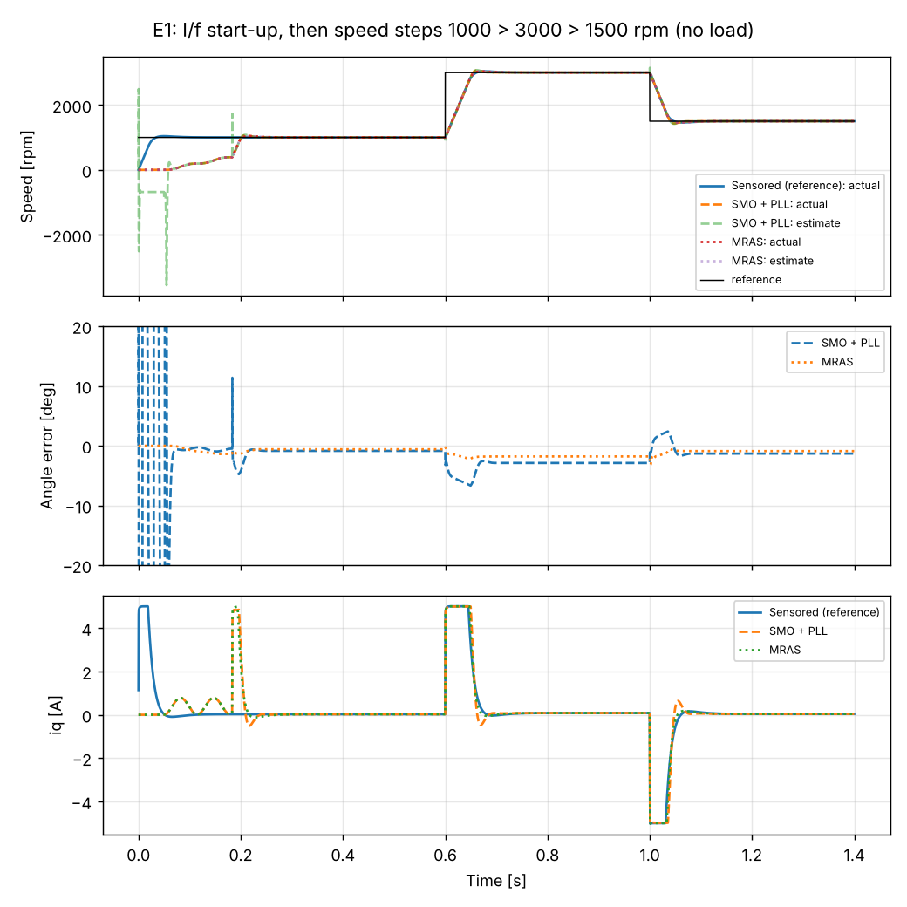
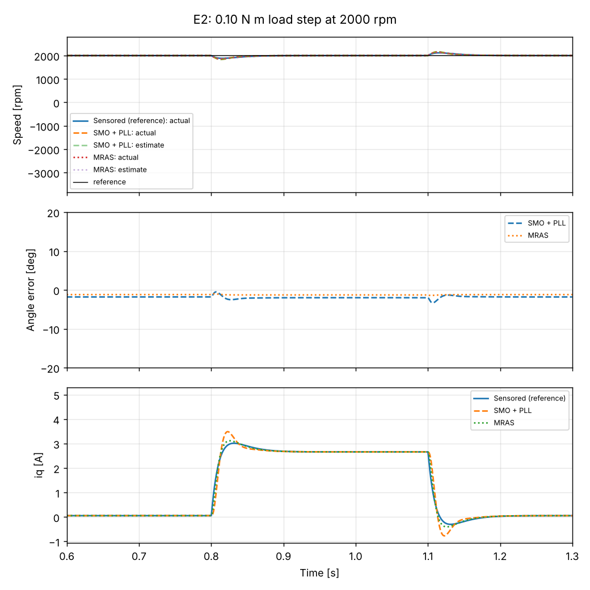

# Sensorless FOC of a PMSM: sliding-mode observer vs MRAS

A reproducible Python simulation of sensorless field-oriented control (FOC) for a surface-mount permanent magnet synchronous motor (PMSM). It compares two speed and position estimators under the same drive:

- **SMO + PLL**: a sliding-mode current observer in the stationary frame, with a phase-locked loop on the estimated back-EMF.
- **MRAS**: a model-reference adaptive system in the estimated rotor frame.

A sensored controller (true rotor angle) runs alongside as the reference. Every figure and number below is produced by one script from a clean checkout.

This project grows out of my final-year project at the University of Lagos, "A Sensorless Speed Control of a Permanent Magnet Synchronous Motor Drive for an Electric Scooter" (supervisor: Dr Adeola Balogun). That project used the MathWorks Motor Control Blockset sensorless FOC reference model. This repository is an independent re-implementation from the machine equations, written so every result can be inspected and reproduced without a MATLAB licence.

## Quick start

```bash
pip install -r requirements.txt
python experiments/run_all.py          # about 30 s; writes results/metrics.csv and results/figures/
python experiments/make_readme_table.py  # refreshes the table below from metrics.csv
python -m pytest -q                    # sanity checks
```

## What is modelled

| Block | Implementation |
| --- | --- |
| Motor | Surface-mount PMSM in the rotor d-q frame (Ld = Lq), RK4 at 100 kHz |
| Inverter | Average-value model, voltage limited to Vdc/sqrt(3) (linear SVPWM range) |
| Current loops | PI in d-q, Kp = Ls*wc and Ki = Rs*wc (pole-zero cancellation), 1 kHz bandwidth, back-EMF and cross-coupling feed-forward |
| Speed loop | PI, 20 Hz bandwidth, current limit 5 A, anti-windup |
| Start-up | 50 ms rotor alignment, then I/f open-loop ramp at 3 A; handover to the estimator at 400 rpm with bumpless transfer |
| SMO | Euler-discretised current observer with saturation (boundary layer) switching, first-order back-EMF filter, normalised PLL with filter-lag compensation |
| MRAS | Current-model adjustable system in the estimated frame, Popov-derived adaptation law, PI adaptation |
| Control rate | 20 kHz |

Motor parameters (in `pmsm_foc/params.py`) are an **illustrative** small 24 V, 4-pole-pair lab PMSM: Rs = 0.36 ohm, Ls = 0.6 mH, psi_f = 6.4 mWb, J = 4.8e-5 kg m^2. They are not measured from a specific motor.

## Experiments

| ID | What it tests |
| --- | --- |
| E1 | Start-up, then speed steps 1000 > 3000 > 1500 rpm with no load |
| E2 | 0.10 N m load step at 2000 rpm, applied at 0.8 s and removed at 1.1 s |
| E3 | Ramp down from 1000 rpm to 300, 150 and 50 rpm with a 0.02 N m load |
| E4 | Controller uses nominal parameters while the simulated motor has Rs +50%, Ls +20% or psi_f -10%; at 2000 and 300 rpm, 0.05 N m load from 1.3 s |
| E5 | E2 repeated with 20 mA rms noise on both measured currents |

"Stayed locked" means the estimated angle stayed within 30 degrees of the true angle from 0.25 s (after start-up) to the end of the run. Mean and max errors are taken over a steady window near the end of each run (see `experiments/run_all.py`).

## Results

Generated by `experiments/run_all.py`; full numbers in `results/metrics.csv`.

<!-- RESULTS:START -->
| Experiment | Estimator | Stayed locked | Mean speed error [rpm] | Mean angle error [deg] | Max angle error in window [deg] | Extra |
| --- | --- | --- | --- | --- | --- | --- |
| E1_speed_steps | Sensored | yes | 0.0 | 0.00 | 0.0 | settling 1000>3000: 55 ms; 3000>1500: 78 ms |
| E1_speed_steps | SMO + PLL | yes | 0.0 | -0.86 | 0.9 | settling 1000>3000: 66 ms; 3000>1500: 59 ms |
| E1_speed_steps | MRAS | yes | 0.0 | -0.60 | 0.6 | settling 1000>3000: 53 ms; 3000>1500: 68 ms |
| E2_load_step | Sensored | yes | -0.3 | 0.00 | 0.0 | dip 117 rpm, recovery 66 ms |
| E2_load_step | SMO + PLL | yes | -0.4 | -2.00 | 2.0 | dip 159 rpm, recovery 58 ms |
| E2_load_step | MRAS | yes | -0.4 | -1.28 | 1.3 | dip 132 rpm, recovery 63 ms |
| E3_low_speed_300rpm | SMO + PLL | yes | 0.0 | -0.30 | 0.3 |  |
| E3_low_speed_300rpm | MRAS | yes | 0.0 | -0.19 | 0.2 |  |
| E3_low_speed_150rpm | SMO + PLL | yes | 0.0 | -0.17 | 0.2 |  |
| E3_low_speed_150rpm | MRAS | yes | 0.0 | -0.10 | 0.1 |  |
| E3_low_speed_50rpm | SMO + PLL | **no** | -5258.0 | -174.23 | 174.3 |  |
| E3_low_speed_50rpm | MRAS | yes | 0.0 | 0.10 | 0.2 |  |
| E4_Rs_plus50_2000rpm | SMO + PLL | yes | 0.0 | -1.87 | 1.9 |  |
| E4_Rs_plus50_2000rpm | MRAS | yes | 0.0 | 0.24 | 0.2 |  |
| E4_Rs_plus50_300rpm | SMO + PLL | yes | 0.0 | -0.33 | 0.3 |  |
| E4_Rs_plus50_300rpm | MRAS | **no** | 0.2 | 31.96 | 33.3 |  |
| E4_Ls_plus20_2000rpm | SMO + PLL | yes | 0.0 | -0.44 | 0.4 |  |
| E4_Ls_plus20_2000rpm | MRAS | yes | 0.0 | 0.21 | 0.2 |  |
| E4_Ls_plus20_300rpm | SMO + PLL | yes | 0.0 | 1.05 | 1.1 |  |
| E4_Ls_plus20_300rpm | MRAS | yes | 0.0 | 1.13 | 1.1 |  |
| E4_psi_minus10_2000rpm | SMO + PLL | yes | 0.0 | -1.93 | 1.9 |  |
| E4_psi_minus10_2000rpm | MRAS | yes | 0.0 | -4.60 | 4.6 |  |
| E4_psi_minus10_300rpm | SMO + PLL | yes | 0.0 | -0.38 | 0.4 |  |
| E4_psi_minus10_300rpm | MRAS | **no** | -152.1 | -63.39 | 141.7 |  |
| E5_current_noise_20mA | SMO + PLL | yes | -0.4 | -2.00 | 2.4 | speed-estimate noise 12.6 rpm rms |
| E5_current_noise_20mA | MRAS | yes | -0.4 | -1.28 | 1.5 | speed-estimate noise 49.6 rpm rms |
<!-- RESULTS:END -->




### What the results show

- With correct parameters, both estimators track the sensored drive closely above 150 rpm. Steady angle errors are a few degrees or less, and the speed responses are almost identical to the sensored case.
- **Low speed.** The SMO loses lock at 50 rpm, where the back-EMF it relies on is only about 0.13 V. The MRAS still holds at 50 rpm, but only because its model parameters are exact here.
- **Parameter sensitivity.** The MRAS is the more fragile of the two at low speed. At 300 rpm, a 50% resistance error gives about 32 degrees of angle error, and a 10% magnet-flux error makes it lose lock. The SMO stays within about 2 degrees in every E4 case.
- **Noise.** With current-sensor noise, the MRAS speed estimate is noisier than the SMO's (see E5). The speed loop still regulates well with both.
- **Discrete-time stability matters.** An earlier version of the SMO used a boundary layer that made the observer's discrete error dynamics oscillate (pole below zero). It worked at high speed but failed at low speed and under load. The fix and the stability condition are explained in `docs/THEORY.md`.

## Limitations (read before quoting any number)

- Simulation only. Nothing here has been validated on hardware yet.
- The inverter is an average-value model: no PWM switching ripple, dead time, device voltage drops or sampling delay. The torque ripple a real drive shows is therefore not represented.
- There is no magnetic saturation, cogging torque or temperature drift of Rs and psi_f.
- Parameters are illustrative, not identified from a real motor.
- Gains were tuned by hand for this motor. The tuning scripts and reasoning are in the code comments and `docs/THEORY.md`.

## Repository layout

```
pmsm_foc/        motor model, transforms, PI controllers, SMO and MRAS estimators, simulation loop, metrics
experiments/     run_all.py (all experiments), make_readme_table.py
results/         metrics.csv and figures (regenerated by run_all.py)
docs/THEORY.md   derivations, tuning rules, stability condition, known failure modes
tests/           quick sanity checks
```

## Next steps

1. Identify Rs, Ls and psi_f of the lab motor and re-run with measured values.
2. Add online Rs estimation to the MRAS to fix its low-speed sensitivity.
3. Add a switching inverter model with dead time.
4. Run the estimators on an STM32 with the inverter and gate-driver boards built for the final-year project.

## Author and acknowledgement

Sunmisola Ganikale, B.Sc. Electrical and Electronic Engineering, University of Lagos. ganikalesunmi@gmail.com

The code was drafted with an AI assistant (Claude, by Anthropic) from the author's final-year project; the author is reviewing, testing and extending it. Extensions written by the author are listed in the changelog below.

## Changelog

- v0.1 (Nov 2026): initial simulation, SMO and MRAS comparison, experiments E1 to E5.

Licence: MIT.
